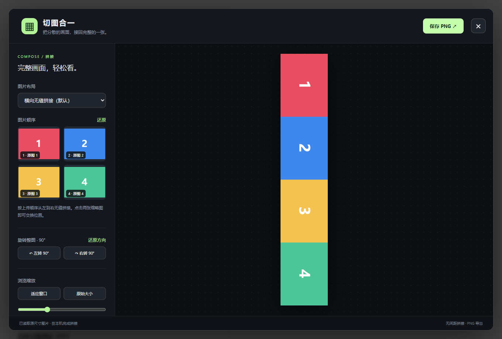

# X 切图合一

一个 Chrome / Edge 浏览器扩展，把 X（Twitter）帖子里分开发出的 2～4 张切图拼回一张图。点击帖子图片下方的 **拼成单图**，直接在当前页面的浮窗中浏览。

- 默认从左到右横向拼接，也可选择竖向或两列布局。
- 点击两张缩略图交换顺序；整图可向左、向右旋转 90°，或还原方向。
- 支持适应窗口、原始大小和手动缩放。保存 PNG 时保留当前旋转方向。

## 安装

1. 在 [Releases](../../releases/latest) 下载扩展 ZIP 并解压，也可直接下载或克隆源码。
2. 打开 `chrome://extensions` 或 `edge://extensions`，开启开发者模式。
3. 点击「加载已解压的扩展程序」，选择直接包含 `manifest.json` 的目录。
4. 刷新 X 网页。更新时，先在扩展管理页重新加载扩展，再刷新 X。

这是无需构建的 Manifest V3 扩展，目前通过本地加载安装。

## 权限与限制

扩展只在 X / Twitter 网页添加按钮，并从 `pbs.twimg.com` 读取切图；图像在本机拼接，无需 API 密钥，不上传图片。优先读取原尺寸图片，失败时回退到较大的可用版本。布局按上传顺序生成，切图的正确顺序可手动调整。

图片需在帖子中正常加载。扩展依赖 X 的页面结构，平台更新后可能需要调整识别规则。Chromium 浏览器验证使用了模拟帖子和图片，详见[验证记录](docs/validation.md)。

## 许可证

[MIT](LICENSE)
